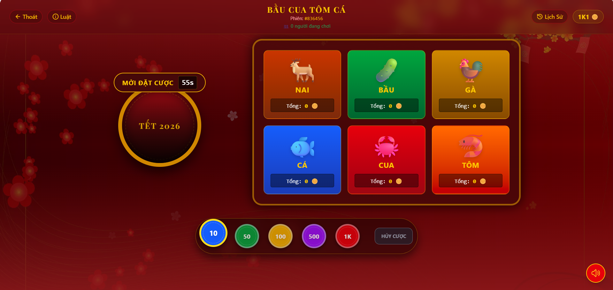
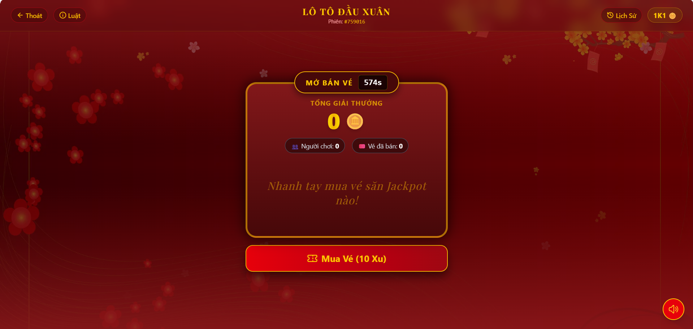
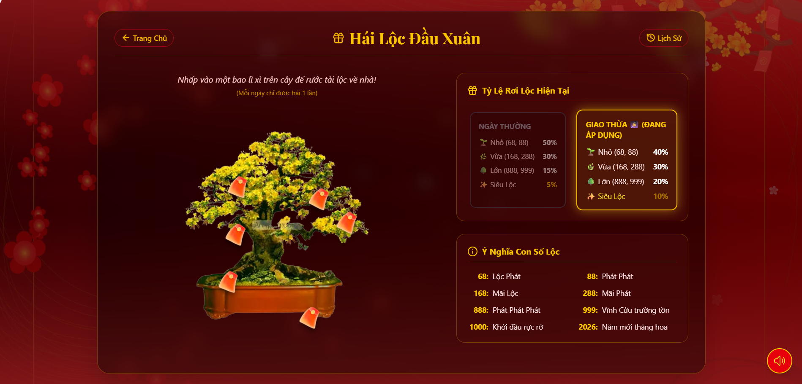
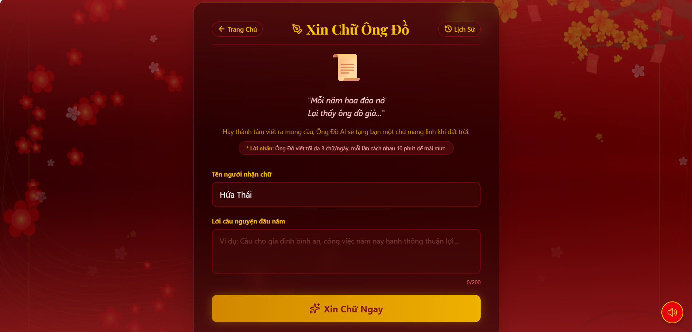

<div align="center">

  <h1>Tết Countdown & Mini Games System</h1>
  <h3>Giao diện Web tương tác Real-time Sảnh Game Ngày Tết</h3>

  <p>
    Một ứng dụng Web hiện đại mang không khí Tết truyền thống lên không gian mạng. 
    Hệ thống cung cấp trải nghiệm mượt mà với các sảnh game dân gian (Bầu Cua, Lô Tô) chơi theo thời gian thực nhiều người, kết hợp các hoạt động tương tác độc đáo như Hái Lộc Đầu Xuân và Xin Chữ Ông Đồ.
  </p>

  <p>
    <strong>Hệ sinh thái Lễ hội & SSO:</strong> Dự án này là một phần của <em>Festive Ecosystem</em>, chia sẻ chung hệ thống tài khoản (Single Sign-On - SSO) và cơ sở dữ liệu với dự án Christmas Wishes. Người dùng chỉ cần đăng ký một lần để trải nghiệm xuyên suốt các mùa lễ hội!
  </p>

  <p>
    
    
    
    
    
    
    
    
  </p>

</div>

<br />

# FRONTEND WEB APPLICATION

Đây là Repository chứa mã nguồn **Frontend**, cung cấp giao diện tương tác trực quan, hiệu ứng sống động và kết nối WebSockets thời gian thực dành cho người chơi.

---

## Mục lục

- [1. Công nghệ & Thư viện Cốt lõi](#1-công-nghệ--thư-viện-cốt-lõi)
  - [Khung Giao diện & Nền tảng Ứng dụng (Core Stack)](#khung-giao-diện--nền-tảng-ứng-dụng-core-stack)
  - [Thiết kế Giao diện & Định kiểu (UI & Styling)](#thiết-kế-giao-diện--định-kiểu-ui--styling)
  - [Mạng & Giao tiếp Thời gian Thực (Networking & Real-time)](#mạng--giao-tiếp-thời-gian-thực-networking--real-time)
  - [Hoạt họa & Tiện ích (Animations & Utilities)](#hoạt-họa--tiện-ích-animations--utilities)
- [2. Tính năng Giao diện & Trải nghiệm Người dùng](#2-tính-năng-giao-diện--trải-nghiệm-người-dùng)
  - [2.1. Sảnh Bầu Cua Tôm Cá (Real-time)](#21-sảnh-bầu-cua-tôm-cá-real-time)
  - [2.2. Sảnh Lô Tô Đầu Xuân (Real-time)](#22-sảnh-lô-tô-đầu-xuân-real-time)
  - [2.3. Hái Lộc & Xin Chữ Đầu Xuân](#23-hái-lộc--xin-chữ-đầu-xuân)
  - [2.4. Trải nghiệm Người dùng (UX) Tối ưu](#24-trải-nghiệm-người-dùng-ux-tối-ưu)
  - [2.5. Xác thực & Định danh (SSO)](#25-xác-thực--định-danh-sso)
  - [2.6. Quản lý Âm thanh Toàn cục (Global State)](#26-quản-lý-âm-thanh-toàn-cục-global-state)
  - [2.7. Trang Lỗi Tùy chỉnh (404 Lễ Hội)](#27-trang-lỗi-tùy-chỉnh-404-lễ-hội)
- [3. Demo Giao diện Người dùng](#3-demo-giao-diện-người-dùng)
- [4. Hướng dẫn Cài đặt & Khởi chạy](#4-hướng-dẫn-cài-đặt--khởi-chạy)
  - [4.1. Yêu cầu Hệ thống (Prerequisites)](#41-yêu-cầu-hệ-thống-prerequisites)
  - [4.2. Clone & Cài đặt Dependencies](#42-clone--cài-đặt-dependencies)
  - [4.3. Cấu hình Môi trường (.env)](#43-cấu-hình-môi-trường-env)
  - [4.4. Các Lệnh Thực thi (Scripts)](#44-các-lệnh-thực-thi-scripts)
- [5. Cấu trúc Thư mục Dự án](#5-cấu-trúc-thư-mục-dự-án)
- [6. Kết nối Backend API Service](#6-kết-nối-backend-api-service)
- [7. Tác giả](#7-tác-giả)

---

## 1. Công nghệ & Thư viện Cốt lõi

Dự án được xây dựng với các công nghệ hiện đại trong hệ sinh thái React / Next.js và đã được nâng cấp phiên bản bảo mật mới nhất:

### Khung Giao diện & Nền tảng Ứng dụng (Core Stack)

| Công nghệ / Thư viện | Phiên bản | Vai trò Kỹ thuật |
| :--- | :--- | :--- |
| **[Next.js](https://nextjs.org/)** | `16.4.3` | Khung ứng dụng React App Router, xử lý Layouts & Routing, Server Components |
| **[React](https://react.dev/)** | `19.3.1` | Thư viện UI cốt lõi phiên bản React 19, xây dựng giao diện Component-based |
| **[react-dom](https://react.dev/learn/rendering-elements)** | `19.3.1` | Thư viện kết xuất DOM cho React |
| **[Zustand](https://zustand.docs.pmnd.rs/)** | `^5.0.16` | Quản lý trạng thái Global Client (duy trì trạng thái nhạc nền xuyên suốt các trang) |
| **[TypeScript](https://www.typescriptlang.org/)** | `^5.x` | Đảm bảo tính an toàn kiểu dữ liệu tĩnh trên toàn bộ dự án |

---

### Thiết kế Giao diện & Định kiểu (UI & Styling)

| Công nghệ / Thư viện | Phiên bản | Vai trò Kỹ thuật |
| :--- | :--- | :--- |
| **[Tailwind CSS](https://tailwindcss.com/)** | `^4.3.3` | Utility-first CSS framework thế hệ v4 với `@tailwindcss/postcss` |
| **[Lucide React](https://lucide.dev/)** | `^1.61.0` | Bộ biểu tượng SVG tối giản, sắc nét và tối ưu cho React |

---

### Mạng & Giao tiếp Thời gian Thực (Networking & Real-time)

| Công nghệ / Thư viện | Phiên bản | Vai trò Kỹ thuật |
| :--- | :--- | :--- |
| **[Socket.io Client](https://socket.io/)** | `^4.8.4` | Kết nối WebSockets, đồng bộ trạng thái Game Real-time với độ trễ thấp |
| **[Axios](https://axios-http.com/)** | `^1.20.0` | HTTP Client có Interceptors gọi RESTful API (Lịch sử, Auth, Thông tin User) |
| **[@react-oauth/google](https://github.com/MomenSherif/react-oauth)** | `^0.13.5` | Cung cấp Provider và Hook xử lý luồng đăng nhập Google OAuth2 |

---

### Hoạt họa & Tiện ích (Animations & Utilities)

| Công nghệ / Thư viện | Phiên bản | Vai trò Kỹ thuật |
| :--- | :--- | :--- |
| **[react-confetti](https://www.npmjs.com/package/react-confetti)** | `^6.4.0` | Hiệu ứng pháo giấy nổ tung màn hình khi trúng thưởng hoặc hái lộc |
| **[@fireworks-js/react](https://fireworks.js.org/)** | `^2.10.8` | Hiệu ứng pháo hoa nền động chân thực |
| **[lunar-javascript](https://github.com/6tail/lunar-javascript)** | `^1.7.7` | Tính toán Lịch Âm, kiểm tra giờ Giao Thừa & Ngày Tết ở Client |
| **[react-use](https://github.com/streamich/react-use)** | `^17.6.1` | Bộ custom hooks đa năng (lấy kích thước màn hình cho Confetti, resize) |

---

## 2. Tính năng Giao diện & Trải nghiệm Người dùng

### 2.1. Sảnh Bầu Cua Tôm Cá (Real-time)
* Giao diện bàn cược trực quan với hiệu ứng Glassmorphism (Kính mờ).
* Đồng bộ đếm ngược, xóc đĩa và hiển thị số lượng người chơi thời gian thực qua WebSockets.
* Popup tính toán và thông báo Lời/Lỗ tự động mượt mà, trực quan.

### 2.2. Sảnh Lô Tô Đầu Xuân (Real-time)
* Thuật toán tự sinh và hiển thị ma trận vé 3x9 chuẩn chỉ.
* Hiệu ứng dạ quang phát sáng các con số được gọi.
* Nút "Kinh!" thông minh: Ẩn/Hiện dựa trên thuật toán kiểm tra hàng ngang tự động.

### 2.3. Hái Lộc & Xin Chữ Đầu Xuân
* **Hái Lộc:** Giao diện chia 2 cột hiện đại, hiển thị rõ tỷ lệ rơi lộc (Ngày thường / Giao thừa). Hiệu ứng rung rinh bao lì xì và nổ pháo giấy khi hái trúng.
* **Xin Chữ:** Giao diện cuộn giấy thư pháp truyền thống, cho phép nhập từ khóa và nhận câu chúc do AI sinh tự động.

### 2.4. Trải nghiệm Người dùng (UX) Tối ưu
* Giao diện Responsive 100%, tự động thay đổi Layout linh hoạt trên Mobile và PC.
* Xử lý triệt để các lỗi Accessibility (viền trắng focus outline) trên trình duyệt Chrome/Edge.
* Ngăn chặn hành vi thao tác sai (Anti-spam clicks) và bảo vệ route bằng Middleware.

### 2.5. Xác thực & Định danh (SSO)
* Tích hợp đăng nhập nhanh bằng Google OAuth2 mượt mà, tiện lợi.
* Giao diện form đăng ký / đăng nhập tích hợp hiệu ứng tương tác (hover/active scale) trau chuốt.
* Hệ thống tài khoản liên thông hoàn toàn với nền tảng Christmas Wishes.

### 2.6. Quản lý Âm thanh Toàn cục (Global State)
* Tách biệt logic âm thanh sử dụng Zustand, đảm bảo nhạc nền và tiếng pháo hoa được duy trì liền mạch, không bị re-render hay đứt quãng khi chuyển đổi giữa các sảnh game.

### 2.7. Trang Lỗi Tùy chỉnh (404 Lễ Hội)
* Giao diện Not Found (404) được thiết kế riêng biệt chuẩn phong cách Tết (kết hợp hiệu ứng lấp lánh, hộp quà và văn phong dí dỏm về Ông Đồ/Lô Tô).

---

## 3. Demo Giao diện Người dùng

### Sảnh Bầu Cua


### Sảnh Lô Tô


### Hái Lộc


### Xin Chữ


---

## 4. Hướng dẫn Cài đặt & Khởi chạy

### 4.1. Yêu cầu Hệ thống (Prerequisites)
* **Node.js:** Phiên bản `>= 20.0.0` (Khuyến nghị **Node.js 20.x** hoặc **22.x LTS**).
* **Trình quản lý gói:** `npm` (>= 9), `yarn`, `pnpm` hoặc `bun`.
* **Backend Service:** Máy chủ **Tet Countdown Backend** đang chạy tại cổng `3001`.

### 4.2. Clone & Cài đặt Dependencies

```bash
# 1. Tải mã nguồn Frontend về máy cục bộ
git clone https://github.com/hvt299/Tet-Countdown-Web.git
cd Tet-Countdown-Web

# 2. Cài đặt toàn bộ thư viện phụ thuộc
npm install
```

### 4.3. Cấu hình Môi trường (.env)

Tạo tệp `.env` tại thư mục gốc của dự án:

```env
NEXT_PUBLIC_API_URL=http://localhost:3001
NEXT_PUBLIC_GOOGLE_CLIENT_ID=YourSecretKeyHere
```

### 4.4. Các Lệnh Thực thi (Scripts)

```bash
# 1. Khởi chạy môi trường phát triển (Dev Server tại port 3000 với Turbopack)
npm run dev

# 2. Biên dịch bản phát hành sản phẩm (Production Build)
npm run build

# 3. Khởi chạy bản production đã biên dịch
npm run start

# 4. Kiểm tra lỗi cú pháp và quy chuẩn mã nguồn (ESLint)
npm run lint
```

Sau khi khởi chạy thành công, truy cập ứng dụng trên trình duyệt tại địa chỉ:
```text
http://localhost:3000
```

---

## 5. Cấu trúc Thư mục Dự án

```text
src/
├── app/                 # Next.js App Router (Pages, Layouts, Middleware)
├── components/          # Reusable UI Components
├── lib/                 # API Calls (Axios interceptors)
├── store/               # Zustand Global States (useMusicStore)
└── utils/               # Utilities (tetHelper)
```

---

## 6. Kết nối Backend API Service

Dự án Frontend này được thiết kế để kết nối trực tiếp với **Tet Countdown Backend** (mặc định chạy tại cổng `3001`):
* Các API Authentication, User profile, Lịch sử trò chơi và máy chủ WebSockets (Bầu Cua, Lô Tô) vận hành đồng bộ qua cổng này.
* Đảm bảo cập nhật chính xác biến môi trường `NEXT_PUBLIC_API_URL=http://localhost:3001`.

---

## 7. Tác giả

Developed by **Mr.T (hvt299)**  
GitHub: [https://github.com/hvt299](https://github.com/hvt299)
